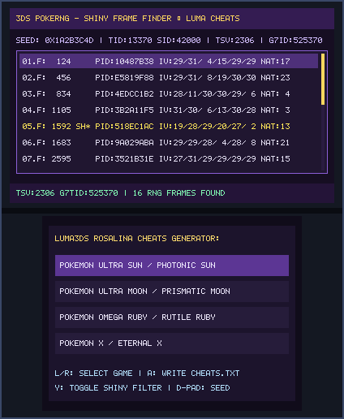
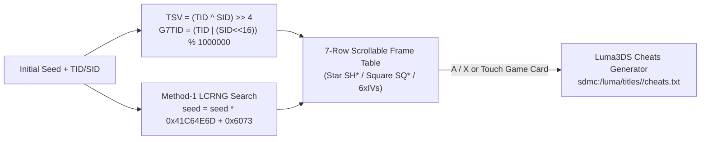

# PokeRNG (`3ds_rngtool`)

<p align="center">
  
  &nbsp;&nbsp;&nbsp;
  
</p>

<p align="center">
  
</p>

> **RNG & Cheat Generator (`CTR-P-PRNG`, UniqueId `0x0D3E5`)** — Part of the [**lafiabrew**](https://github.com/orgs/lafiabrew/repositories) Nintendo 3DS Homebrew Suite (companion hub: [`lafiabrew/3ds_hub`](https://github.com/lafiabrew/3ds_hub)).

On-console Pokémon RNG shiny frame finder (`LCRNG 0x41C64E6D * seed + 0x6073`), Trainer Shiny Value (`TSV`) & Gen 7 `G7TID` calculator, and 1-button Luma3DS Rosalina `cheats.txt` generator.

---

## Architecture & Data Flow



---

## Controls & Touch Ergonomics (Old 3DS · 2DS · New 3DS XL)

| Button / Input | Action |
|---|---|
| `D-Pad Up / Down` | Scroll through discovered Shiny (`SH*` / `SQ*`) and high-IV RNG frames (with scrollbar) |
| `D-Pad Left / Right` | Adjust initial RNG seed (`-0x100` / `+0x100`) and recompute frames |
| `Y` | Toggle filter between **`SHINY + HIGH IV`** and **`SHINY ONLY`** |
| `L` / `R` (or Touch Game Card) | Select target Pokémon 3DS game (`Ultra Sun`, `Ultra Moon`, `Omega Ruby`, `X`) |
| `A` / `X` (or Double-Tap Card) | Atomically write `sdmc:/luma/titles/<TitleID>/cheats.txt` (with `.bak` backup) |
| `START` | Exit to HOME Menu / Homebrew Launcher |

---

## SD Card Paths & Telemetry Logs

- `sdmc:/luma/titles/<TitleID>/cheats.txt` — Luma3DS Rosalina cheat file (enable in-game via `L + Down + Select` → Cheats)
- `sdmc:/luma/titles/<TitleID>/cheats.txt.bak` — Automatic backup of previous cheat file
- `sdmc:/3ds/logs/rngtool.log` — Structured UTC operational log

---

## Build, Verify & Install

```bash
# 1. Run host C11 ASan/UBSan pass-the-pass & fail-the-fail unit + UI tests
make test

# 2. Build optimized ARM11 (-Os -flto + stripped ELF) .elf, .smdh, .3dsx, and .cia
make 3ds && make verify-3ds

# 3. Serve FBI QR code or push .cia over LAN via serve_3ds.py
make qr
```
